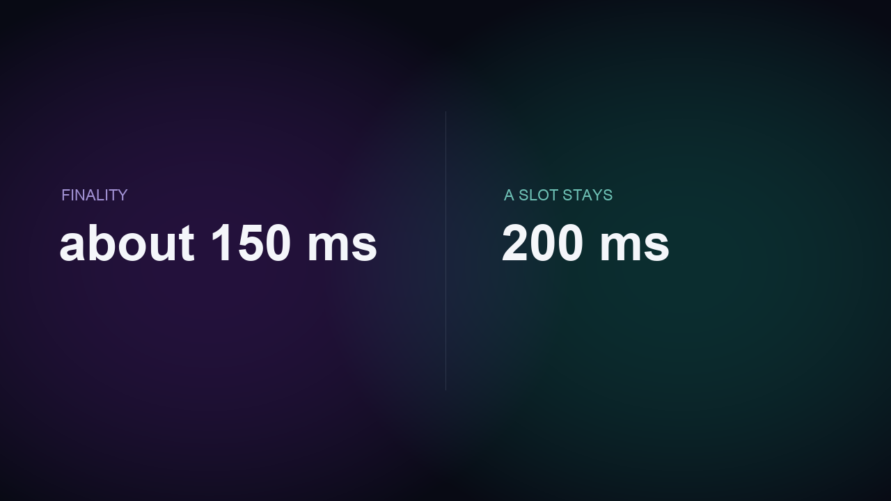

On Wednesday, 21 October 2026, Solana mainnet-beta moved from TowerBFT
 consensus to **Alpenglow**. TowerBFT is how validators have agreed on blocks
 since the network launched, and it is history now. A block can be final in
 about **150 milliseconds**. A slot lasts **200 milliseconds**.

<figure class="cms-figure cms-figure-hero">
  
  <figcaption>Finality is the moment a payment can no longer be undone (Alpenglow). The
   slot stays 200ms: the leader's turn to produce a block.</figcaption>
</figure>

**Epoch 1064** began at
 [slot 459,648,000](https://explorer.solana.com/block/459648000), and the
 network's own timestamp places that slot at **13:36:05 UTC**. The feature
 gate turned on there. Consensus did not change at that moment.
 [Anza marked the next stretch](https://x.com/anza_xyz/status/2112900712179077620)
 "Migration in progress," with about 17 minutes on the timer: **5,000 slots**
 of TowerBFT. In the event, they took 17 minutes and 55 seconds. The Alpenglow
 genesis certificate covered
 [slot 459,652,999](https://explorer.solana.com/block/459652999) at
 **13:54:00 UTC**.
 [Anza had named](https://x.com/anza_xyz/status/2112520675365900505) slot
 459,653,000 as the migration boundary: one slot, and TowerBFT is out. That
 slot and the seven after it are not on the ledger. The next block is
 [slot 459,653,008](https://explorer.solana.com/block/459653008), at 13:54:03
 UTC.
 [Anza confirmed the switch](https://x.com/anza_xyz/status/2112905478921736411)
 a few minutes later. Eighteen months of work, and a migration built to finish
 inside a single slot. Finality, the moment a block can no longer be undone,
 is aimed at about **150 milliseconds**.

The slot does not move. Since
 [epoch 1053, on 9 October](./solana-200ms-slots-october-2026.html), a slot
 lasts **200 milliseconds**: that is the leader's turn. A block is what the
 leader produces during that turn. Alpenglow pulls a different lever: how long
 the network waits before that block becomes irreversible. How this upgrade
 looked in July, and how public testnet worked through the switch in
 September, is in the
 [July note](./alpenglow-consensus-status-july-2026.html) and the
 [Alpenswitch piece](./alpenswitch-testnet-september-2026.html).

## What actually changes

Alpenglow replaces TowerBFT, the way Solana's validators have agreed on blocks
 since the network launched.
 [SIMD-0326](https://github.com/solana-foundation/solana-improvement-documents/blob/main/proposals/0326-alpenglow.md)
 is that consensus. The voting protocol inside it is called **Votor**.

Under TowerBFT a validator voted with a transaction, and those votes were
 packed into the blocks. Votor takes the votes off the ledger. They become
 direct messages between validators, each signed so they can be gathered into
 one certificate. A block becomes final after one or two of those rounds, not
 after a long stack of confirmations.

Votor runs two races at once. If the validators holding **80%** of the
 network's total stake respond in a single round, that race closes the block.
 If the answers come in more slowly, a second round can close it at **60%** of
 that same stake. Whichever race finishes first is the result, and Anza puts
 that at about 150 milliseconds.

Proof of History no longer sets the pace of block production. Each node keeps
 its own timer now. If a leader goes quiet, the others vote to skip it, a skip
 certificate forms, and the chain moves on. The slot remains. What disappears
 is the steady tick that used to mark time inside it.

Votes used to take up a large share of the transactions in a block. They now
 free that room for user transactions. A board that counted votes will show a
 sharp drop. That drop is the missing votes, not a quieter network. The SVM,
 transaction formats, and fees do not change with this switch. Rotor, a later
 change to how a block's data spreads across the network, is not part of this
 activation.

What can go wrong changes too. TowerBFT was built to neutralize the influence
 of validators who behave dishonestly. Alpenglow is built so the network keeps
 working even when **20%** of the network's stake is actively attacking it and
 another **20%** is simply offline.

## In plain terms

A validator's yes used to be written into the following blocks, and the
 network waited seconds for enough of those blocks to pile up. Validators now
 say yes directly to one another, so it never lands in a block.

A payment becomes final in about 150 milliseconds once the yeses reach about
 **80%** of the network's total stake (what counts is the SOL delegated to
 them, not the number of validators), or **60%** of that same stake if a
 second round is needed. The leader's turn, the slot, still lasts 200
 milliseconds, and a block is simply what the leader produces during that turn.

<strong>Analogy</strong>
A class is deciding something together. Each student used to mail a letter,
 and the teacher could not say "settled" until a pile of mail had arrived over
 several days. Now everyone is in the same room: they show they agree, and the
 question is closed in a moment, the way a payment becomes final in about 150
 milliseconds rather than in the seconds spent waiting on blocks.

## Two indicators, and the old numbers

This is the place where it is easy to get it wrong. There are two different
 indicators. **150 milliseconds** is finality: how long you wait before a
 payment can no longer be undone. **200 milliseconds** is the slot, the
 leader's turn; a block is what the leader produces during that turn.
 Shortening the slot, which
 [happened on 9 October](./solana-200ms-slots-october-2026.html), changed only
 the second figure. Alpenglow changes the first: finality becomes about 150ms,
 and the slot still lasts 200ms.

The other number that is easy to misread is **12.8 seconds**. That is TowerBFT
 finality, calculated from the original 400ms slot (32 slots at 400ms). On
 today's 200ms clock, that same stack of 32 slots is about **6.4 seconds**.
 [Anza's message](https://x.com/anza_xyz/status/2112905478921736411) puts the
 change this way: finality falls from 12.8 seconds to 150 milliseconds. Both
 12.8 and 6.4 are how long people used to wait for TowerBFT finality, not how
 long a 200-millisecond slot lasts.

`confirmed` and `finalized` are the same thing now: Votor is already running
 on mainnet-beta.

## What this means for…

### Validators

The gate required **v4.3.2**: Agave, Jito-Solana, or Harmonic Salsa.
 [Anza announced that release](https://x.com/anza_xyz/status/2111124479908970527)
 on 16 October.
 [Firedancer and Frankendancer](./firedancer-live-on-mainnet.html) were not
 part of this migration. An operator who stayed on either one was outside the
 switch.

The per-slot vote transaction goes away. In its place the **Validator
 Admission Ticket** takes **0.8 SOL per epoch** from the vote account and burns
 it. On top of that ticket, the account still has to hold its rent-exempt
 minimum.
 [The July note](./alpenglow-consensus-status-july-2026.html) carried an
 earlier proposal of 1.6 SOL. The identity account paid for votes under
 TowerBFT. It does not pay this ticket. If the vote account cannot cover the
 charge, the validator produces no blocks the next epoch.

Keep **0.8 SOL plus the rent-exempt minimum** on the vote account every epoch
 (the balance there often comes to about **0.83 SOL**). The first charge is
 taken at the start of epoch 1064, and it pays for epoch 1065.

### Delegators

If you stake natively, there is nothing you need to do, unless you have
 already noticed trouble with your validator. If the operator misses the client
 change or drains the vote account, that validator cannot produce blocks or
 earn block rewards for those slots in the next epoch, and that cuts into what
 your stake earns.

### Builders

A substantial increase in speed opens new possibilities. For founders coming from
 Web2, Solana is a more attractive place to build. What you cannot mix up is
 the two figures. A confirmation screen can treat finality as about 150ms. The
 slot stays 200ms: do not record 150ms as the new block time. Fees, the SVM,
 and transaction formats do not change. Vote transactions leave the blocks, so
 a TPS chart that included them falls even though user traffic did not.

### Everyday users

If you hold or send SOL, there is nothing to set up. A transfer can become
 irreversible in about 150 milliseconds, rather than several seconds. Fees stay
 the same.

<strong>In short</strong>
        The day is here: Alpenglow is already running on Solana mainnet-beta.
        Epoch 1064 opened the gate at slot 459,648,000, at 13:36:05 UTC. The
        genesis certificate covers slot 459,652,999, at 13:54:00 UTC. Validators
        agree by a direct vote instead of on-chain receipts, a block can be
        final in about 150ms, and a slot lasts 200ms.

Sources:
 [Anza – Alpenglow is live on mainnet-beta, 21 October 2026](https://x.com/anza_xyz/status/2112905478921736411) ·
 [Anza – Migration in progress, 21 October 2026](https://x.com/anza_xyz/status/2112900712179077620) ·
 [Anza – migration boundary, slot 459,653,000, ~14:00 UTC, 20 October 2026](https://x.com/anza_xyz/status/2112520675365900505) ·
 [Anza – epoch 1064 tracking earlier, 19 October 2026](https://x.com/anza_xyz/status/2112246102506565825) ·
 [Anza – Agave v4.3.2, 16 October 2026](https://x.com/anza_xyz/status/2111124479908970527) ·
 [Anza – first mark, ~14:50 UTC, 13 October 2026](https://x.com/anza_xyz/status/2110021831445156266) ·
 [Anza – Alpenglow](https://anza.xyz/alpenglow) ·
 [Solana – Alpenglow](https://solana.com/upgrades/alpenglow) ·
 [SIMD-0326](https://github.com/solana-foundation/solana-improvement-documents/blob/main/proposals/0326-alpenglow.md) ·
 [SIMD-0384](https://github.com/solana-foundation/solana-improvement-documents/blob/main/proposals/0384-alpenglow-migration.md)
