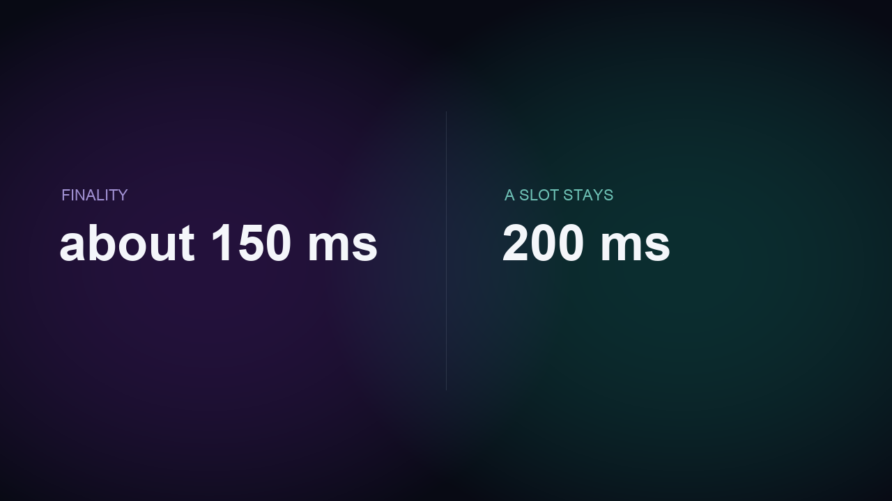

У середу, 21 жовтня 2026, Solana mainnet-beta перейшла з консенсусу TowerBFT
 до **Alpenglow**. TowerBFT – це те, як валідатори узгоджували блоки від моменту
 запуску мережі, і він тепер вже історія. Блок може стати остаточним приблизно
 за **150 мілісекунд**. Слот триває **200 мілісекунд**.

<figure class="cms-figure cms-figure-hero">
  
  <figcaption>Фіналізація – це мить, коли платіж уже не скасувати (Alpenglow). Слот
   лишається 200 мс: черга лідера виробити блок.</figcaption>
</figure>

**Епоха 1064** розпочалася на
 [слоті 459 648 000](https://explorer.solana.com/block/459648000), і мітка часу
 мережі ставить цей слот на **13:36:05 UTC**. Там увімкнувся feature gate.
 Консенсус у ту мить не змінився.
 [Anza позначила наступний відрізок](https://x.com/anza_xyz/status/2112900712179077620)
 як «Migration in progress» з близько 17 хвилинами на таймері – **5 000 слотів**
 TowerBFT. По факту, вони зайняли 17 хвилин і 55 секунд. Genesis-сертифікат
 Alpenglow покрив
 [слот 459 652 999](https://explorer.solana.com/block/459652999) о
 **13:54:00 UTC**.
 [Anza називала](https://x.com/anza_xyz/status/2112520675365900505) слот
 459 653 000 межею міграції: один слот, і TowerBFT виходить з роботи. Цього
 слота і семи наступних у леджері немає. Наступний блок –
 [слот 459 653 008](https://explorer.solana.com/block/459653008), о 13:54:03
 UTC.
 [Anza підтвердила перехід](https://x.com/anza_xyz/status/2112905478921736411)
 за кілька хвилин. Вісімнадцять місяців роботи і міграція зібрані так, щоб
 завершитися всередині одного слота. Фіналізація – мить, коли блок уже не
 скасувати, – має орієнтир близько **150 мілісекунд**.

Слот не зрушується. З
 [епохи 1053, 9 жовтня](./solana-200ms-slots-october-2026.html), слот триває
 **200 мілісекунд**: це черга лідера. Блок – це те, що лідер виробляє за цю
 чергу. Alpenglow має інший важіль: скільки мережа чекає, перш ніж цей блок
 стане незворотним. Як це оновлення виглядало в липні і як публічний testnet
 відпрацьовував перехід у вересні – у
 [липневій нотатці](./alpenglow-consensus-status-july-2026.html) і в
 [матеріалі про Alpenswitch](./alpenswitch-testnet-september-2026.html).

## Що насправді змінюється

Alpenglow замінює TowerBFT – спосіб, яким валідатори Solana узгоджували блоки
 від запуску мережі.
 [SIMD-0326](https://github.com/solana-foundation/solana-improvement-documents/blob/main/proposals/0326-alpenglow.md)
 – це саме цей консенсус. Протокол голосування всередині нього називається
 **Votor**.

За TowerBFT валідатор голосував транзакцією, і ці голоси складалися всередині
 блоків. Votor виносить голоси з леджера. Вони стають прямими повідомленнями
 між валідаторами, кожне підписане так, щоб їх можна було зібрати в один
 сертифікат. Блок стає остаточним після одного чи двох таких раундів, а не
 після довгого стосу підтверджень.

Votor веде два забіги одночасно. Якщо відповідають валідатори, на яких стоїть
 **80%** загального стейку мережі, за один раунд, цей забіг закриває блок. Якщо
 відповіді йдуть повільніше, другий раунд може закрити його на **60%**. Чий
 забіг закінчиться першим, таким і буде результат, і Anza говорить про
 приблизно 150 мілісекунд.

Proof of History перестає задавати темп виробництва блоків. Тепер кожен вузол
 тримає власний таймер. Якщо лідер замовкає, інші голосують за те, щоб його
 пропустити, складається skip-сертифікат, і ланцюг йде далі. Слот лишається.
 Зникає рівний тік, який раніше позначав час усередині нього.

Голоси займали велику частку транзакцій у блоці. Зараз вони звільняють місце
 для користувацьких транзакцій. Дошка, яка рахувала голоси, покаже різке
 падіння. Це падіння – зниклі голоси, а не тихіша мережа. SVM, формати
 транзакцій і комісії цим перемикачем не змінюються. Rotor, пізніше
 впровадження щодо того, як дані блока розходяться мережею, у цю активацію не
 входить.

Змінюється й те, скільки всього може піти не так. TowerBFT був зведений з
 метою нейтралізувати вплив валідаторів, які поводяться нечесно. Alpenglow
 зібраний так, щоб мережа працювала навіть коли **20%** стейку мережі активно
 атакує її і ще **20%** просто не на зв’язку.

## Простими словами

Раніше «так» валідатора записували в наступні блоки, і мережа чекала секунди,
 поки цих блоків збереться багато. Тепер валідатори кажуть «так» прямо одне
 одному, тож у блок воно не потрапляє.

Платіж стає остаточним приблизно за 150 мілісекунд, щойно «так» набирає близько
 **80%** загального стейку мережі (рахують делегований SOL, а не кількість
 валідаторів), або **60%** того ж стейку, якщо знадобився другий раунд. Черга
 лідера, слот, і далі триває 200 мілісекунд, а блок – це просто те, що лідер
 робить за цю чергу.

<strong>Аналогія</strong>
Клас вирішує щось разом. Раніше кожен учень надсилав листа, і вчитель не міг
 сказати «вирішено», поки за кілька днів не зійшлося багато посилок. Тепер усі
 в одній кімнаті: показали згоду, і питання закрите за мить – як платіж, який
 стає остаточним за близько 150 мілісекунд, а не за секунди очікування на
 блоки.

## Два індикатори і старі цифри

Ось місце, де важливо не помилитися. Тут два різні індикатори. **150
 мілісекунд** – фіналізація: скільки чекати, перш ніж платіж уже не скасувати.
 **200 мілісекунд** – слот, черга лідера; блок – те, що лідер робить за цю
 чергу. Скорочення слота, яке
 [відбулося 9 жовтня](./solana-200ms-slots-october-2026.html), змінювало лише
 другий показник. Alpenglow змінює перший: фіналізація стає близько 150 мс, а
 слот і далі триває 200 мс.

Інша цифра, яку можна неправильно зрозуміти, – **12,8 секунди**. Це фіналізація
 TowerBFT, порахована відповідно до оригінального слота у 400 мс (32 слоти по
 400 мс). На сьогоднішньому такті 200 мс той самий стос із 32 слотів – це
 близько **6,4 секунди**.
 [Повідомлення Anza](https://x.com/anza_xyz/status/2112905478921736411)
 формулює зміну так: фіналізація падає з 12,8 секунди до 150 мілісекунд. І 12,8,
 і 6,4 – це скільки раніше чекали на фіналізацію TowerBFT, а не скільки триває
 слот у 200 мілісекунд.

`confirmed` і `finalized` тепер одне й те саме: Votor уже працює на
 mainnet-beta.

## Що це означає для…

### Валідаторів

Gate вимагав **v4.3.2**: Agave, Jito-Solana або Harmonic Salsa.
 [Anza оголосила цей реліз](https://x.com/anza_xyz/status/2111124479908970527)
 16 жовтня.
 [Firedancer і Frankendancer](./firedancer-live-on-mainnet.html) у цій міграції
 не брали участі. Оператор, який лишився на одному з них, був поза переходом.

Vote-транзакція на кожен слот зникає. Замість неї **Validator Admission
 Ticket** бере **0,8 SOL за епоху** з vote-акаунта і спалює їх. На акаунті,
 понад цей квиток, має лишатися rent-exempt мінімум.
 [Липнева нотатка](./alpenglow-consensus-status-july-2026.html) містила ранішу
 пропозицію 1,6 SOL. Identity-акаунт платив за голоси при TowerBFT. Цей квиток
 він не платить. Якщо vote-акаунт не може заплатити, валідатор не виробляє
 блоків наступної епохи.

Тримайте на vote-акаунті **0,8 SOL плюс rent-exempt** мінімум що епоху (разом
 на рахунку часто виходить приблизно **0,83 SOL**). Перше списання – на старті
 епохи 1064, і воно оплачує епоху 1065.

### Делегаторів

З нативним стейком нічого робити не треба, хіба що ви помітили якісь проблеми
 зі своїм валідатором, адже якщо оператор пропустить зміну клієнта або осушить
 vote-акаунт, наступної епохи він не зможе виробляти блоки й отримувати block
 rewards за ці слоти, що, відповідно, негативно вплине на заробіток від вашого
 стейку.

### Білдерів

Відкриваються нові можливості завдяки суттєвому збільшенню швидкості мережі.
 Для фаундерів з Web2 Solana стає ще привабливішою. Однак тут дуже важливо не
 сплутати два значення. Екран підтвердження може рахувати фіналізацію як
 близько 150 мс. Слот лишається 200 мс: не записуйте 150 мс як новий час блока.
 Комісії, SVM і формати транзакцій не змінюються. Vote-транзакції виходять із
 блоків, тож графік TPS, який їх включав, падає, хоча користувацький трафік не
 впав.

### Звичайних користувачів

Якщо ви тримаєте чи надсилаєте SOL, нічого налаштовувати не треба. Переказ може
 стати незворотним приблизно за 150 мілісекунд, а не за кілька секунд. Комісії
 лишаються тими самими.

<strong>Коротко</strong>
        Цей день настав: Alpenglow вже працює на Solana mainnet-beta. Епоха 1064
        відкрила gate на слоті 459 648 000, о 13:36:05 UTC. Genesis-сертифікат
        покриває слот 459 652 999, о 13:54:00 UTC. Валідатори домовляються
        прямим голосом замість ончейн-квитанцій, блок може стати остаточним
        приблизно за 150 мс, а слот триває 200 мс.

Джерела:
 [Anza – Alpenglow працює на mainnet-beta, 21 жовтня 2026](https://x.com/anza_xyz/status/2112905478921736411) ·
 [Anza – Migration in progress, 21 жовтня 2026](https://x.com/anza_xyz/status/2112900712179077620) ·
 [Anza – межа міграції, слот 459 653 000, ~14:00 UTC, 20 жовтня 2026](https://x.com/anza_xyz/status/2112520675365900505) ·
 [Anza – епоха 1064 іде раніше, 19 жовтня 2026](https://x.com/anza_xyz/status/2112246102506565825) ·
 [Anza – Agave v4.3.2, 16 жовтня 2026](https://x.com/anza_xyz/status/2111124479908970527) ·
 [Anza – перша позначка, ~14:50 UTC, 13 жовтня 2026](https://x.com/anza_xyz/status/2110021831445156266) ·
 [Anza – Alpenglow](https://anza.xyz/alpenglow) ·
 [Solana – Alpenglow](https://solana.com/upgrades/alpenglow) ·
 [SIMD-0326](https://github.com/solana-foundation/solana-improvement-documents/blob/main/proposals/0326-alpenglow.md) ·
 [SIMD-0384](https://github.com/solana-foundation/solana-improvement-documents/blob/main/proposals/0384-alpenglow-migration.md)
