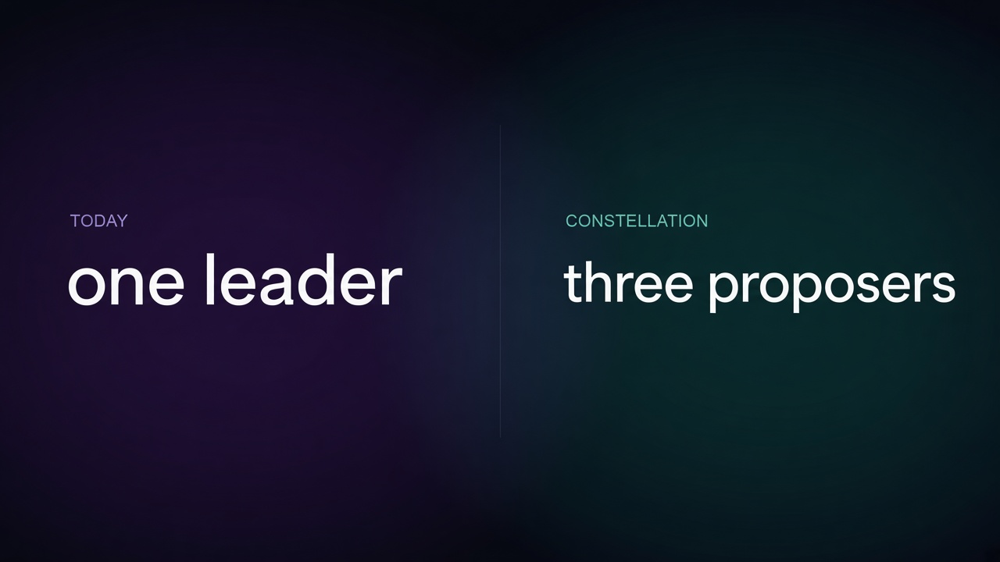

17 листопада 2026 року керівник Anza Бреннан Ватт виступив на головній сцені Breakpoint у Лондоні, розповівши про план змін мережі на 2027 рік. Сьогодні блок збирає один лідер. За Constellation збиратимуть кілька валідаторів одразу.

<figure class="cms-figure cms-figure-hero">
  
  <figcaption>Сьогодні один лідер. Constellation: троє збирають блок.</figcaption>
</figure>

## Що оголосили

- Спрощення протоколу Solana
- Більше місця в блоках і дешевші транзакції
- Швидша передача черги наступному лідеру, врахування того, де стоїть валідатор, і Rotor: наступний спосіб розносити блок по мережі
- Новий принцип побудови блоку Constellation
- Ще дешевші транзакції, щоб на самій мережі можна було рахувати, наприклад, ціни опціонів

Наразі це поки що напрямки в плані змін на наступний рік.

## Детальніше про зміни

Сьогодні слот належить одному валідатору, лідеру. Слот це його черга зібрати блок. Черга триває 200 мілісекунд. Лідер бачить транзакції, які чекають, і сам вирішує, які з них увійдуть і в якому порядку.

За Constellation цю чергу отримають двоє або троє валідаторів одночасно. Кожен збиратиме транзакції. Мережа потім вишикує їх за комісією, яку платить кожна. Порядок не обиратиме жоден валідатор сам. Транзакція користувача потрапить у блок, якщо її візьме хоча б один із них.

Свій блок кожен фіксуватиме раніше, ніж зможе прочитати чужі. Тому черга чесна: ніхто не перепише її, вже побачивши, що зібрали інші.

Згідно з пропозицією авторів нового механізму, Квентіна Кніпа і Роджера Ваттенгофера, у їхній статті від 14 листопада черга триватиме 50 мілісекунд. Нова пачка транзакцій могла б потрапляти в блок у чотири рази частіше, ніж зараз. Підтвердження від цього не швидшає. Валідатори й далі голосуватимуть через [Alpenglow](./alpenglow-mainnet-october-2026.html), приблизно кожні 200 мілісекунд. Платіж стає остаточним приблизно за 150 мілісекунд: той самий орієнтир, який у мережі є тепер.

## Простими словами

Уявіть стійку, за якою працює один службовець. Протягом певного часу кожен лист має пройти через руки цієї людини. Вона вирішує, які листи відправити далі, а які залишити чекати, і може підсунути власний лист на початок черги.

Constellation ставить за цю стійку одразу двох або трьох службовців. Ваш лист вирушає далі, щойно хтось із них візьме його до рук. Черговість визначає розмір сплаченого вами поштового збору, а не чиєсь особисте рішення. Кожен службовець запечатує свою стопку листів, перш ніж дізнається, що взяли інші, тож ніхто не змінює порядок у черзі, підглянувши за колегами.

## Важливо не переплутати

Alpenglow це згода. Коли стейку достатньо, мережа каже: блок остаточний, його вже не скасувати. Так мережа працює з 21 жовтня. Constellation цього не замінює. Constellation це крок перед голосуванням: кому можна класти транзакції в блок.

Є пастка в назві. У березні 2026 року Anza вже публікувала інший задум під тим самим словом. Там лідер лишався, а хтось інший лише перевіряв його роботу. На Breakpoint ішлося про листопадовий задум: слот збирають кілька валідаторів, і єдиного лідера немає.

## Що ще попереду

Немає програми для оновлення і немає дати, коли це увімкнуть. Листопадовий текст це дослідницька стаття. Відкритими лишаються дві практичні речі: як ділити комісії, і чи зможуть валідатори з різних міст збирати один і той самий слот. Поки що двоє чи троє, які збирають слот, мають сидіти близько, практично в одному місті. Їм треба за приблизно 10 мілісекунд обмінятися відбитком блока. Валідатор, який далеко, усе одно голосує. Блоків він не збирає.

## Після зміни

**Користувачам.** Якщо ви надсилаєте SOL, нічого налаштовувати не треба. Єдині двері в блок не належатимуть одному лідеру. Хто перший у черзі, і далі вирішуватиме комісія.

**Валідаторам.** Нічого встановлювати не треба. Коли з'явиться дата, нове питання буде про місце: де знаходиться машина. Голосування лишається в будь-якому разі. Щоб збирати блоки, треба бути поруч із тими, з ким ділиш чергу.

<strong>Коротко</strong>
        Зі сцени Anza озвучила план щодо протоколу Constellation: валідатори
        змагатимуться за транзакцію користувача. Двоє або троє валідаторів
        збиратимуть один слот, а порядок задасть комісія. Остаточним блок і
        далі робитиме Alpenglow. Це план Anza на 2027 рік.

Джерела:
 [Кніп і Ваттенгофер, New Constellation, 14 листопада 2026](https://github.com/wattenhoferSOL/solanaMCP/blob/main/New%20Constellation%20v1.0.pdf) ·
 [Anza, березневий допис про Constellation, 25 березня 2026](https://www.anza.xyz/blog/constellation) ·
 [Open Solana Hub, Alpenglow на mainnet](./alpenglow-mainnet-october-2026.html)
